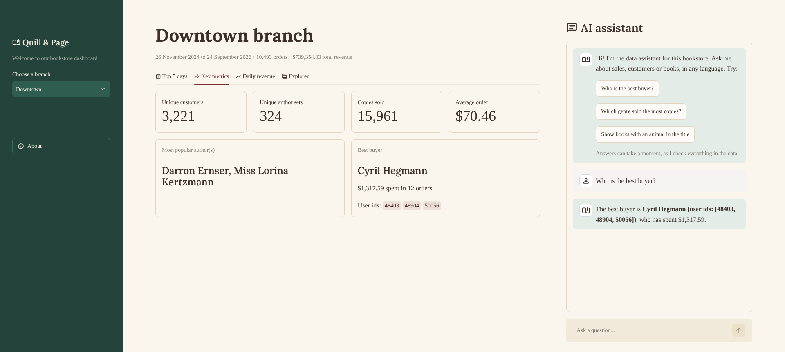
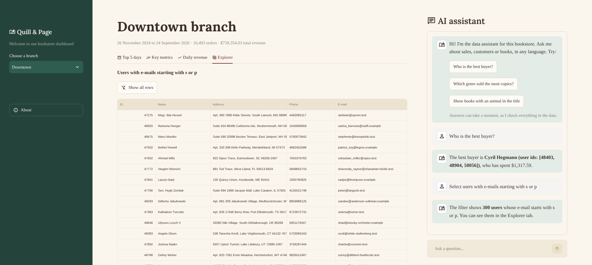

# Quill & Page: Bookstore AI Dashboard

Sales dashboard for a bookstore with five branches, with an **AI assistant that answers questions about the data in any language** and filters the tables on request. The raw data is messy (mixed currencies, date formats and duplicate customers), so it is cleaned first, and every number the assistant gives comes from a SQL query, not from a guess.

🚀 [Live app](https://bookstore-dashboard-sawaniewska.streamlit.app)



**Stack:** Python, Streamlit, pandas, DuckDB, NetworkX, Altair, Groq API (gpt-oss-120b)

## What it does

- **Data cleaning.** Prices written in different ways (`$`, `¢`, `€`, `EUR`) are converted to USD, timestamps in several formats are parsed, duplicate orders are removed and invalid book years are cleared.
- **Customer matching.** One person can have several accounts with one changed detail. Accounts that match on 3 of 4 fields (name, address, phone, e-mail) are linked in a graph and counted as one customer.
- **Dashboard per branch:** top 5 days by revenue, key metrics, daily revenue with a 7-day average, and an Explorer for the raw tables.
- **AI assistant:**
  - turns questions into SQL and runs them read-only in DuckDB, so answers are based on the real data;
  - answers in the language of the question;
  - filters the Explorer on request, e.g. "users with e-mails starting with s or p";
  - handles filters that need understanding, e.g. "books with an animal in the title": the model checks every title, and the code accepts only ids that really exist;
  - can compare branches and switch between them.



The assistant runs on Groq's free plan, so complex questions can take a minute.

## Run locally

```bash
pip install -r requirements.txt
```

Add a free Groq API key to `.streamlit/secrets.toml`:

```toml
GROQ_API_KEY = "your-key"
```

```bash
streamlit run app.py
```

## Files

| File | Purpose |
|---|---|
| `app.py` | Streamlit dashboard and chat |
| `assistant.py` | AI assistant: tools, SQL guard, filters |
| `store.py` | Data loading, cleaning and customer matching |
| `explore.py` | First look at the raw data |
| `.streamlit/config.toml` | Theme |

The data was provided by Itransition for training purposes, as part of the Data Engineering internship program.
